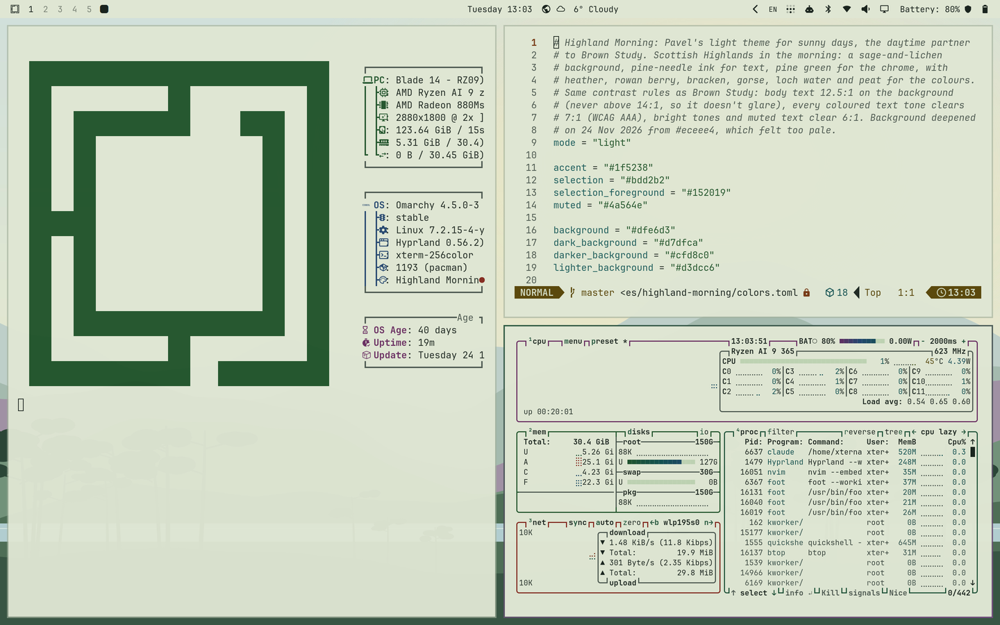
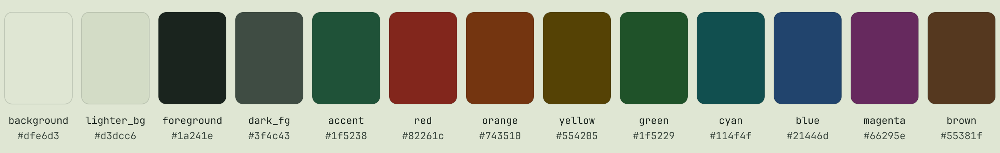

# Highland Morning

A light theme for [Omarchy](https://omarchy.org), for sunny days: the Scottish Highlands in the morning. It's bright enough to feel cheerful and calm enough to keep you focused.



## Install

```bash
omarchy theme install https://github.com/xternal/omarchy-highland-morning
```

## Palette



- **Background** `#dfe6d3`, a soft sage and lichen rather than white, so a light screen doesn't dazzle. Text is a dark pine ink, `#1a241e`, at 12.5:1, and nothing goes above 14:1.
- **Colours from the hills**: heather, rowan berry, bracken, gorse, loch water, pine and peat. Every coloured text tone clears 7:1 (WCAG AAA); bright tones and muted text clear 6:1.
- **Pine green marks the chrome**: accent `#1f5238`, and window borders run from pine to heather.

## Wallpapers

Three drawn for the theme: a misty glen with a loch, Scots pines and a heather slope; fine ridge lines; and plain morning mist. Cycle them with **Super + Ctrl + Space**.

## Pairs with

[Brown Study](https://github.com/xternal/omarchy-brown-study), a warm dark brown theme for evenings with the same contrast rules. Switch between the two by hand, or at sunrise and sunset with a small timer.

## FAQ

**Will it work in my terminal and editor?** Yes. Omarchy builds the terminal, Neovim, btop, Claude Code and other app colours from `colors.toml`, so they all follow the theme.

**Why not pure white?** A pale sage is easier on the eyes over a long day, and it lets the greens and heather read as part of a landscape rather than as warnings.

## Licence

MIT, including the wallpapers.

---

Made by [Pavel Guzhikov](https://guzh.uk) · [Buy me a coffee](https://ko-fi.com/pavelg)
